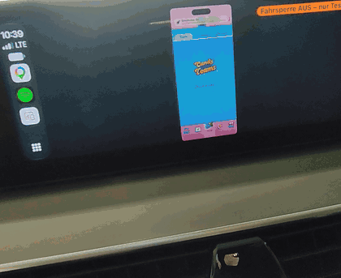

# DashMirror

Mirror your whole iPhone screen into your own CarPlay window: any app, including games you play with a Bluetooth
controller. No jailbreak, no IPA injection, no extra hardware ([details](#no-hacks-no-extra-hardware)). A fail-closed
driving lock hides the picture while the car is moving.

New and experimental: [Touch in the car](#touch-in-the-car-experimental). Tap the car screen and the app in front on
the iPhone reacts, as if you touched the iPhone. Off by default, with a setup of its own.



Full test video in the BMW, 3:37 with chapters: [youtu.be/DnrtX1dW0b4](https://youtu.be/DnrtX1dW0b4)

> **Use only while parked.** Not affiliated with, endorsed by, or connected to Apple. CarPlay is a trademark of
> Apple Inc. This is a hobby project, not an App Store app. See [Limitations](#limitations) and
> [Use at your own risk](#use-at-your-own-risk).

## Status (November 2026)

| Area | State |
|---|---|
| Works | iPhone 16 Pro, iOS 27.0.1, in Apple's CarPlay Simulator and in a real BMW with wireless CarPlay (23 Nov 2026): mirroring, rotation, picture formats, touches on the car screen. |
| Not tested yet | Wired CarPlay in a real car (only in Apple's CarPlay Simulator, which is wired). Instant replay, blurred background, night mode and heat protection in a real car; so far they have only run in the simulator. iOS 27.2 and later: Apple cracked down on CarPlay video workarounds in 27.2 (App Store removals), and whether this approach is affected is unknown. |
| Touch in the car (experimental) | Works in Apple's CarPlay Simulator and in the BMW with wireless CarPlay (24 Nov 2026): taps and swipes on the car screen control the app in front on the iPhone, games included. Needs the iPhone on Wi-Fi, which wireless CarPlay already is; with wired CarPlay, mobile data off. See [Touch in the car](#touch-in-the-car-experimental). |
| Driving lock | Locks at once above 7 km/h (GPS) and unlocks after 5 s of standing. Without precise GPS it stays locked. The rule lives in `DashMirror/Driving/DrivingPolicy.swift`; check it before use (see [Driving lock](#driving-lock)). |
| UI language | English and German. Follows the iPhone language, or pick one under **Language** in the app. The switch is immediate, on the car screen too. |

## What it does

- Mirrors whatever is in front on the iPhone into a CarPlay window, at the car display's resolution and 30 or 60 fps.
- [Four picture formats](#picture-formats) with an adjustable zoom, plus pinch zoom.
- [Cuts off black borders](#black-borders-and-blurred-background) that games leave themselves, and fills any remaining
  bars with a blurred copy of the picture.
- [Instant replay](#instant-replay): a long press on the car screen saves the last 30 seconds to Photos.
- [Night mode](#night-mode), [a dark iPhone while mirroring](#dim-the-iphone) and [heat protection](#heat-protection).
- [Touch in the car](#touch-in-the-car-experimental) (experimental, opt-in): one finger on the car screen controls the
  iPhone.
- Switches between English and German without a restart.

## No hacks, no extra hardware

DashMirror only uses what iOS offers every developer:

- No jailbreak. It runs on a normal iPhone with a current iOS.
- No modified apps. Nothing is injected into the apps you mirror; they run unchanged.
- No extra devices. No CarPlay dongle, no Android box, no HDMI adapter, no Raspberry Pi. Just the iPhone and the
  car's normal CarPlay connection.
- No private APIs for the mirroring. The screen capture is a regular ReplayKit broadcast that you start yourself, like
  a screen recording. Encoding, transport and display use VideoToolbox, a Unix socket and AVFoundation.
- No DRM tricks. Protected video stays black.

One part is not standard: the car screen is a plain UIKit window under CarPlay's window scene role, which Apple
doesn't document. iOS only creates that window for apps with both CarPlay entitlements, and you request those from
Apple yourself (see [Requirements](#requirements) and [Limitations](#limitations)).

The optional [Touch in the car](#touch-in-the-car-experimental) goes further, and you should know how: it talks to
the iPhone's own developer services, the ones Xcode uses, through a loopback VPN. No private framework is linked and
nothing is jailbroken, but the protocol is undocumented, it needs Developer Mode and a pairing file that works like a
key to your iPhone, and Apple can close it with any update. It is off unless you build and switch it on.

## How it works

```text
iPhone screen (game in front, controller paired to the iPhone)
   │ ReplayKit broadcast: every frame as CMSampleBuffer (always portrait + EXIF orientation)
   ▼
MirrorBroadcast.appex  (separate process, hard 50 MB limit)
   │ scale to the car display's size → H.264 (VideoToolbox, hardware, low-latency rate control)
   │ Unix domain socket in the App Group container
   ▼
DashMirror.app
   │ SPS/PPS + frames → CMSampleBuffer → AVSampleBufferDisplayLayer (hardware decoder)
   │ rotation via layer transform, driving lock hides the picture
   ▼
CarPlay window (UIWindowScene under the role "UIWindowSceneSessionRoleCarPlay")
```

The game's sound needs no extra path: iOS already plays it through CarPlay. The app never activates an audio
session, so it doesn't interrupt that.

By default, touch on the car screen does not reach the mirrored app. No public API lets one app inject touches into
another, so you control the game with a controller on the iPhone, and taps on the car screen go to DashMirror itself
(see [Usage](#usage)). The experimental [Touch in the car](#touch-in-the-car-experimental) changes that.

The CarPlay window is a plain `UIWindowScene` under a scene role that UIKit exports but doesn't name in Swift.
[rPlayAI/cafari-lite](https://github.com/rPlayAI/cafari-lite) found it. iOS only creates that scene for an app signed
with both CarPlay entitlements, video and audio.

## Requirements

- A paid Apple Developer account, Xcode 26.3 or later, and an iPhone with iOS 26.2 or later (tested on 27.0.1).
- For the car screen, Apple must grant both **CarPlay Video App** and **CarPlay Audio App** to your App ID
  ([developer.apple.com/contact/carplay](https://developer.apple.com/contact/carplay/)). With video alone the app
  never appears in the car, and you get no error. Without the entitlements everything else still works on the phone:
  the mirroring pipeline, the test pattern and the phone UI.

## Setup

```bash
git clone https://github.com/developer2013/dashmirror.git
cd dashmirror
cp Config/Local.xcconfig.example Config/Local.xcconfig
```

1. In `Config/Local.xcconfig` (git-ignored), set your team ID, bundle ID and App Group.
2. Open `DashMirror.xcodeproj` and run once on your iPhone. Automatic signing registers both App IDs (`BUNDLE_ID` and
   `BUNDLE_ID.MirrorBroadcast`) and the App Group.
3. Only if Apple granted both CarPlay entitlements: enable them for your App ID in the developer portal, set
   `DASHMIRROR_ENTITLEMENTS = Config/DashMirror-CarPlay.entitlements` in `Local.xcconfig`, and build once in Xcode so
   it fetches a fresh provisioning profile. An old profile fails with *"Entitlements … not found and could not be
   included in profile"*.

## Usage

1. Pair a Bluetooth controller with the iPhone.
2. Connect to CarPlay and open DashMirror on the car screen.
3. On the iPhone, tap **Start mirroring**, then **Start Broadcast**. Or open Control Center, long-press
   **Screen Recording** and choose **DashMirror**.
4. Switch to your game, put the iPhone down in landscape and play with the controller.
5. Set **Auto-Lock** to **Never**. Locking the iPhone ends the broadcast.

On the car screen:

| Gesture | Action |
|---|---|
| Tap | Control bar: picture format, save clip, stats, reset zoom. Hides after 4 s. |
| Long press | Save a clip of the last 30 s. |
| Pinch | Zoom. |
| Drag | Move the zoomed picture. |

With [Touch in the car](#touch-in-the-car-experimental) switched on and connected, one finger goes to the iPhone
instead and these gestures pause. Change picture format and zoom on the iPhone meanwhile.

Whether a head unit delivers multi-touch depends on the car (Apple's CarPlay Simulator doesn't), so the iPhone has the
same zoom as a slider (**Extra zoom**, on top of the picture format), plus a reset button. Frame rate (30/60) and quality (6/12/20 Mbit/s) are set on the iPhone and
apply immediately. The resolution follows the car display.

Hold the iPhone in landscape. Its picture is 2.17:1 and fills a wide car display almost completely. Portrait apps stay
a narrow strip with the blurred background behind it; zoom helps there.

## Features

### Picture formats

The format button in the control bar cycles through them. The iPhone shows each one with a short explanation.

| Format | What it does |
|-|-|
| Fit | Whole picture, black bars. |
| Zoom (default) | Zooms in, but cuts off at most the **Zoom amount** set on the iPhone (0–15 %, default 6 %). The rest stays as a border. |
| Fill | Fills completely, edges are cut off. |
| Stretch | Fills completely, distorted. |

In the BMW (2.45:1 display, iPhone landscape 2.17:1), filling cuts off 11.4 % of the height. The first version had seven
formats, and in landscape three of them (Automatic, Slight zoom, Fill) came out identical at those 11.4 %, which was
too close. The stretch variants were hard to tell apart. So the zoom is now adjustable. In landscape, 0 % equals Fit,
6 % cuts 6 % and leaves a 5.8 % border, and 11.4 % or more is borderless. Portrait apps barely change with it.

### Black borders and blurred background

Many games leave black bars for the Dynamic Island or render 16:9 on the 19.5:9 screen. The extension detects them and
crops before encoding, so the actual content gets bigger. Per axis it only cuts what is black on both sides. When
content reaches into a border, the crop shrinks at once; it only grows after 2 s of stable measurements, so dark scenes
don't zoom. Toggle: **Cut off black borders**.

Behind the picture, the same picture fills the whole car window, enlarged and blurred, like portrait videos on TV. Like
native CarPlay apps, this background also runs under the floating CarPlay sidebar. The sharp picture stays in the safe
area, so the sidebar never covers the game. It gets rounded corners, about 5 % of the display height, which is the
radius CarPlay uses for its own app area (12 pt in the BMW, measured from a photo). The background is a second display
layer with its own hardware decoder. Because the corners and the strip under the sidebar always show it, it now runs
whenever the toggle is on. With the test pattern in the simulator: still 30 fps, 5 ms, nothing dropped. Toggle:
**Blurred background instead of black bars** (off = black behind the picture).

### Instant replay

The app keeps the last 30 s of the stream it already receives: encoded H.264, in groups that each start with a
keyframe (the encoder sets one at least every 2 s), capped at 64 MB. Saving only wraps those frames into an MP4 with
`AVAssetWriter` passthrough, without re-encoding. In the simulator, 12 s of video took 0.04 s. The rotation goes into
the track transform.

Clips go to Photos with "add only" access. iOS can only ask for that access while the DashMirror window is in front on
the iPhone. Until then, clips wait in the Files app (**On My iPhone › DashMirror › Clips**) and move to Photos the next
time you open the app. Clips are video only, because the extension sends no audio. A new picture format (car display
change, border crop) or orientation starts the buffer over.

### Night mode

Dims the car picture with a black layer, 15 to 70 %. **Automatic** follows the car's day/night signal: CarPlay switches
the window's appearance (`userInterfaceStyle`) by headlights or light sensor, the same signal navigation apps use for
their maps. Some cars report night all the time, so the iPhone shows what the car reports.

### Dim the iPhone

Optional, off by default (**Dim the iPhone while mirroring**). While the picture runs in the car and another app is in
front on the iPhone, for example a video, DashMirror turns the iPhone's brightness down to 2 %. Unlike a game app that
draws its own car picture, DashMirror can't show a black screen on the iPhone, because the iPhone screen *is* the
mirrored picture. Only the backlight goes down, and ReplayKit captures the picture, not the backlight. The brightness
is dimmed when you leave DashMirror and restored when you come back, when the mirroring ends or when the car
disconnects. iOS itself restores it at the next lock. If iOS refuses the restore while DashMirror is in the background,
the log says so and the next time you open DashMirror restores it. Code: `DashMirror/Phone/PhoneDimmer.swift`.

### Heat protection

The app checks the iPhone's thermal state every 0.5 s. At *serious* it lowers the resolution to 75 % and the data rate
to 8 Mbit/s, at *critical* to 67 %, 6 Mbit/s and 30 fps. That happens before iOS throttles the game on its own, and the
car screen shows a short note. The rule is one small function in `DashMirror/Mirror/ThermalPolicy.swift`. It keeps
60 fps as long as possible, because smoothness usually matters more in games than sharpness on a small car display.

## Touch in the car (experimental)

Tap or swipe on the car screen, and the app in front on the iPhone reacts as if you touched the iPhone: open apps,
scroll, play touch games, pause a video. One finger. Off by default; without the steps below DashMirror builds and
behaves exactly as without it.

**Use it only while parked.** The touch layer exists only while the picture is shown, so the
[driving lock](#driving-lock) switches touch off together with the picture.

### How it works

```text
Finger on the car screen (CarPlay window, DashMirror)
   │ point → iPhone screen position: the picture's layer transform (rotation, zoom, move) undone
   ▼
TouchBridge (Rust static library on top of idevice, own thread)
   │ TCP to 10.7.0.1 – LocalDevVPN routes this back into the same iPhone
   │ Remote Pairing (with the pairing file) → encrypted tunnel → service directory (RSD)
   │ displayservice: a screen stream must run, otherwise iOS drops the touches; its data is discarded
   ▼
hid.universalhidservice (from the Developer Disk Image): touchscreen reports, 0…65535 per axis
   ▼
iOS treats it as a real finger – in whatever app is in front
```

This is the service Xcode uses to operate an iPhone from the Mac. The iPhone simply talks to itself as if it were that
Mac. While it runs, the iPhone shows its screen-sharing indicator.

### What you need

- Everything from [Requirements](#requirements), plus Developer Mode on the iPhone (Settings › Privacy & Security).
- [rustup](https://rustup.rs) with the `aarch64-apple-ios` target, to build TouchBridge.
- [pymobiledevice3](https://github.com/doronz88/pymobiledevice3) on the Mac, for the pairing file and the Developer
  Disk Image.
- [LocalDevVPN](https://apps.apple.com/app/localdevvpn/id6755608044) on the iPhone (free, App Store). iOS runs one VPN
  at a time, so another VPN (Tailscale, WireGuard, …) is off while it is on.
- **The iPhone on Wi-Fi, or mobile data off.** With mobile data on and no Wi-Fi the tunnel fails (`device socket io
  failed`). Wireless CarPlay covers this: the iPhone is on the head unit's Wi-Fi, and in the BMW touch connected with
  mobile data on. Wired CarPlay doesn't count as Wi-Fi (measured in Apple's CarPlay Simulator, which is wired), so
  with a cable you need another Wi-Fi network or mobile data off.

### Setup

1. Build TouchBridge and switch it on in your local config:

   ```bash
   brew install rustup        # or https://rustup.rs
   /opt/homebrew/opt/rustup/bin/rustup toolchain install stable --profile minimal --target aarch64-apple-ios
   scripts/build-touchbridge.sh
   echo '#include? "TouchBridge.xcconfig"' >> Config/Local.xcconfig
   ```

   Build and run DashMirror on the iPhone. Simulator builds and builds without that line contain an empty stub.
2. Connect the iPhone by cable, unlock it, and pair it with pymobiledevice3 once. This also mounts the Developer Disk
   Image the touch service lives in:

   ```bash
   pip install pymobiledevice3
   pymobiledevice3 mounter auto-mount
   pymobiledevice3 developer core-device get-device-info
   ```

3. Put the pairing file into DashMirror:

   ```bash
   scripts/make-pairing-file.sh      # PMD3=/path/to/pymobiledevice3 if it is not in PATH
   ```

4. On the iPhone: install LocalDevVPN and connect it.
5. In DashMirror on the iPhone: **Touch in the car (experiment) › Forward touch to the iPhone**. Allow
   **Local Network** when iOS asks. The status turns **ready** after about a second.
6. In the car: open DashMirror, start mirroring. The car screen shows *Touch goes to the iPhone*.

After every restart of the iPhone, mount the Developer Disk Image again from a Mac
(`pymobiledevice3 mounter auto-mount`). If the touch service is missing although the image is mounted, use
`--replace` (seen once on 24 Nov 2026). A lost connection (app in the background, network change) is retried
automatically: at once when the car window or the app comes back, otherwise after 3, 5, 10, 20, then every 30 s.

### The pairing file is a key

Whoever has it gets full developer access to your iPhone, also over the same Wi-Fi: install apps, read the screen,
tap. `make-pairing-file.sh` builds it in a private temporary folder and deletes it after copying. DashMirror moves it
at its next start out of Documents (which the Files app shows) into Application Support, with file protection and
excluded from backups. Never commit it, attach it to an issue or send it to anyone.

It is the Remote Pairing that pymobiledevice3 made for your Mac (listed as *Mac* under Settings › Privacy &
Security › Developer Mode). To revoke it, remove that entry there; pymobiledevice3 pairs again the next time you use
it, then run `make-pairing-file.sh` again.

### Limits

- One finger. Pinch and other multi-finger gestures are not passed on (the reports could carry five fingers;
  CarPlay head units often deliver only one).
- While touch is on, black borders are not cut off: the app can't know how much the extension cuts, and the taps
  would land off target. DashMirror's own car gestures (control bar, zoom, clip) pause; use the iPhone for those.
- Taps on the blurred background or under the CarPlay sidebar do nothing; only the visible picture counts.
- The screen stream that unlocks touch costs a little: in the BMW 17–21 ms from screen to app with touch, 12–21 ms
  without.
- The Remote Pairing port is 49152; if that fails, DashMirror looks it up via Bonjour (launch argument
  `-TouchForwardingPort N` forces one).
- Apple can change or close any part of this path with an iOS update. On iOS 27.2 some people report the Remote
  Pairing tunnel failing with other tools ([StikDebug #471](https://github.com/StikDebug/StikDebug/issues/471)).

## Driving lock

Every second, `DrivingLockMonitor` collects the GPS speed, the motion coprocessor's automotive/stationary state with
its confidence, the seconds since the last movement, and whether location access is available.
`DrivingPolicy.shouldLock` decides. The monitor starts locked, and missing data never counts as parked. When locked,
the picture is removed from the car screen (no frozen frame) and the decoder stops.

**GPS first.** With a fresh GPS speed that iOS rates accurate to ±5 km/h, only the speed decides whether the car
moves. Without one (tunnel, garage, start-up), the motion coprocessor's "driving" also counts as movement. Reason: in
the BMW with the engine idling, the coprocessor kept reporting "in car, moving" while GPS showed 0 km/h,
so "stationary for" never left 0 s.

**The rule** (`DrivingPolicy.swift`): locked without precise location access or without an accurate GPS speed; locked
at once above 7 km/h; after moving, unlocked once the car has stood for 5 s (`unlockAfterSeconds`). The car screen
names the reason: driving, waiting for GPS, or precise location needed. While locked, the 10 s log line includes the
measurements.

Location also runs in the background (blue status pill), because in the car the game is in front on the iPhone.

In Germany, § 23 (1a) StVO allows a driver to use the screen only when the car is stopped and the engine is off.
Start-stop does not count, and the app cannot detect the engine. The default rule unlocks after 5 s at a red light too,
with the engine running. Make it stricter (e.g. a longer `unlockAfterSeconds`) if you want it closer to "parked".

## Testing without a car

```bash
xcodebuild -project DashMirror.xcodeproj -scheme DashMirror \
  -destination "generic/platform=iOS Simulator" -derivedDataPath build build
```

ReplayKit doesn't run in the simulator, so real mirroring needs a device. The rest of the chain can be tested with
these launch arguments (Debug builds only):

| Launch argument | What it does |
|---|---|
| `-MirrorTestPattern YES` | Sends a test pattern through the same chain as the extension: encoder, socket, border crop, decoder, rotation. Also a toggle in the app. |
| `-MirrorNoDrivingLock YES` | Disables the driving lock for this launch only. The car screen shows a permanent orange badge. |
| `-MirrorCarPreview YES` | Shows the car screen in the iPhone window, so the control bar, blurred background and night mode can be checked without a CarPlay display. |
| `-MirrorShowControls YES` | Keeps the control bar visible. |
| `-MirrorReplayTest 12` | Saves a clip after 12 s (file only, no Photos). |
| `-MirrorThermalTest serious` | Fakes the thermal state. The simulator always reports *nominal*. |

The test pattern is drawn portrait with orientation `.right`, like ReplayKit with the iPhone in landscape, and shows a
16:9 game with black side bars. If "↑ top" stands upright, "top left" is in the top left corner and the bars disappear
after about 2 s, rotation and cropping work.

With the iPhone on a cable, Apple's CarPlay Simulator (Additional Tools for Xcode) shows the car screen on the Mac.

## Measurements

| Setup | Result |
|---|---|
| BMW, real car, iPhone 16 Pro, wireless CarPlay (23 Nov 2026) | CarPlay window 642×240 pt @3x (1440×540 native), 49 pt sidebar → 1770×723 px video area (2.45:1). 30–57 fps, 12–21 ms from screen to app. |
| BMW, second drive (23 Nov 2026) | All seven old formats compared in portrait and landscape. Landscape apps with zoom looked best, but Fill-level zoom (11.4 % cut) was too close, which led to the adjustable zoom. 11–16 ms from screen to app, 0–0.1 dropped/s. After dark the car reported night. Whether it switches to day still needs a test in daylight. The `-MirrorNoDrivingLock` launch ended after 55 min (no crash or jetsam report). The next normal launch was locked again, as intended. |
| iPhone + CarPlay Simulator, real broadcast | Car window 425×255 pt @2x (800×480 native), 49 pt safe-area inset → 752×510 px video area; the encoder follows (346×752). Extension: 4 MB at start, 9–10 MB while encoding (limit 50 MB). 23 ms from screen to app including ReplayKit. |
| iPhone 16 Pro, iOS 27.0.1, test pattern | Hardware low-latency encoder, 30 fps, 9 ms encoder → app. |
| Simulator, test pattern | 30 fps, 4–7 ms encoder → app. The simulator has no low-latency encoder (`-12908`) and ignores `MaxFrameDelayCount` (`-12900`). Its encoder held frames back and deadlocked a "max 2 in flight" back-pressure rule. Fixed: without low-latency, force output after every frame, plus a 0.5 s escape hatch. |
| Simulator, 16:9 test pattern with black bars | Bars detected and cut about 2 s after start: 136 px per side (the bars are 140 px; the 4 px rest is the safety margin). The encoder switches from 720×1560 to 720×1288, no frames dropped. |
| Simulator, instant replay | `-MirrorReplayTest 14`: a clip of 11.7 s (the buffer restarted when the border crop changed the format), 353 frames, 0.6 MB, written in 0.04 s. It plays upright as 1288×720 with the rotation in the track transform. |
| Simulator, heat protection | `-MirrorThermalTest serious`: encoder settings go from 1920×1080 at 12 Mbit/s to 1440×810 at 8 Mbit/s, 60 fps kept. |
| Simulator, blurred background | Second display layer next to the main one, no decoder errors. 0.2 frames/s were dropped for a moment while it waited for its first keyframe. |
| Touch, from the Mac (24 Nov 2026) | `pymobiledevice3 … universal-hid-service tap` during a running DashMirror broadcast: 5 of 5 taps landed, 2.05–2.06 s apart in a 2 s rhythm. With the screen stream open but no taps, the mirroring dropped to 29–30 fps and 13–14 ms for about 20 s, then back to 30 fps and 8 ms. Nothing dropped, no back-pressure. |
| Touch, CarPlay Simulator + Wi-Fi (24 Nov 2026) | Switch on → ready in 1.1 s. Clicks in the simulator window open apps on the iPhone. Mirroring 35–37 fps, 14–16 ms (8–9 ms without touch). |
| Touch, BMW with wireless CarPlay (24 Nov 2026) | Taps, swipes, a touch game and YouTube worked. Car window 639×241 pt, 1770×723 px picture area, 31–47 fps, 17–21 ms from screen to app, nothing dropped. Connected with mobile data off at first; later it reconnected and ran with mobile data on (LTE in the CarPlay status bar), because the iPhone is on the head unit's Wi-Fi. The first drop came from the app sitting in the background, which is why it now reconnects by itself. |
| Touch, wired CarPlay Simulator, Wi-Fi off (24 Nov 2026) | Mobile data on: tunnel fails (`device socket io failed`). Mobile data off: connects. The USB link to the head unit doesn't count as Wi-Fi. |
| Touch, wrong port (24 Nov 2026) | `-TouchForwardingPort 1`: connection refused → Bonjour found 49152 within 30 ms → ready 1 s later. |

ReplayKit's orientation `.right` (6) needs a 90° counter-clockwise rotation, the opposite of the EXIF reading. The
first version showed YouTube upside down in the BMW. Netflix stays black: ReplayKit doesn't capture DRM content, by
design.

ReplayKit only delivers frames when the screen changes, so a static screen means few frames, not an error.

Locking the iPhone ends the broadcast. In the measurement iOS finished it 7 s after CarPlay connected, when the phone
was locked, and after unlocking it has to be started again. The game is suspended while locked anyway. So even with
[Touch in the car](#touch-in-the-car-experimental), the iPhone has to stay unlocked: "phone locked, play by car touch"
is not possible with mirroring.

## Logs

Both processes write to the App Group container (`Logs/app.log`, `Logs/broadcast.log`, viewable and shareable in the
app under **Log**) and a copy into their own container, because `devicectl` may not read App Group containers. The
app's copy is also in the Files app (**On My iPhone › DashMirror › Logs**).

```bash
xcrun devicectl device copy from --device DEVICE_ID --domain-type appDataContainer \
  --domain-identifier BUNDLE_ID --source Documents/Logs/app.log --destination app.log
xcrun devicectl device copy from --device DEVICE_ID --domain-type appDataContainer \
  --domain-identifier BUNDLE_ID.MirrorBroadcast --source Documents/Logs/broadcast.log --destination broadcast.log
```

## Limitations

- Not for the App Store. The window scene role is undocumented, and Apple's CarPlay video category requires apps
  "designed primarily to provide video playback services" built with Apple's templates. Apple removed comparable apps
  in October 2026. Build it for yourself.
- Don't distribute signed builds to others. Apple grants CarPlay entitlements to your team under its terms.
- Capture, hand-over and the CarPlay video stream add latency. End-to-end latency hasn't been measured yet.
- DRM-protected content (streaming apps) is black in ReplayKit captures.
- Apple can change or remove the window scene role in any iOS release.
- Touch in the car depends on undocumented developer services, Developer Mode, a mounted Developer Disk Image and a
  loopback VPN, and needs Wi-Fi or mobile data off. See its [limits](#limits).

## Use at your own risk

DashMirror is a hobby project. The code is free and comes as is, without warranty (see [LICENSE](LICENSE)).

If you build it, what you do with it is your responsibility. That includes requesting CarPlay entitlements from
Apple, adding them to your own App ID, writing the driving-lock rule and changing the code. Whether that fits Apple's
developer agreements is between you and Apple. The CarPlay window is meant for a parked car, so don't watch or play
while driving.

To the extent permitted by law, I'm not liable for damage, lost data, fines, trouble with your developer account or
anything else that comes from building, changing or using DashMirror.

## Open tests

- Pseudo-standby, an untested idea. iOS ends the broadcast when the iPhone locks, so real standby is out. Instead, keep
  the iPhone unlocked with the game in front but make its screen practically dark: **Reduce White Point** at 100 %
  (Accessibility › Display & Text Size) plus minimum brightness, toggled with the Accessibility Shortcut (triple-click
  the side button), and Auto-Lock set to **Never**. iOS applies these filters when displaying, and screenshots don't
  contain them, so ReplayKit probably captures the normal, bright picture. To check: does the car picture stay bright
  while the iPhone looks off? [Dim the iPhone](#dim-the-iphone) does the brightness half of this automatically.
- Dim the iPhone: does the car picture stay bright at 2 % brightness, does iOS accept the restore while DashMirror is in
  the background (log line `iPhone-Helligkeit …`), and does auto-brightness raise the brightness again during a
  session?
- Wired CarPlay in a real car, longer sessions with a warm iPhone, switching between Maps and DashMirror.
- The new features in a real car: does the blur render on the head unit, does the BMW send a day/night signal (the log
  line is `Autodisplay: Auto meldet …`), does heat protection kick in on a warm day, how big is the control bar on the
  240 pt high screen.
- iOS 27.2 and later.
- Touch in the car: other head units, wired CarPlay in a real car, longer sessions. Mounting the Developer Disk Image
  on the iPhone itself, without a Mac, after a restart.

## Project layout

| Part | Files |
|---|---|
| Wire protocol, socket helpers | `Shared/MirrorProtocol.swift` |
| Encoder (scale + H.264, frame rate, back-pressure, keyframes) | `Shared/MirrorEncoder.swift` |
| Socket client with reconnect; `MirrorStreamer` = encoder + sender | `Shared/MirrorSender.swift` |
| Broadcast extension | `MirrorBroadcast/SampleHandler.swift` |
| Socket server, CMSampleBuffer assembly | `DashMirror/Mirror/MirrorReceiver.swift`, `MirrorPipeline.swift` |
| App state, settings, stats | `DashMirror/Mirror/MirrorHub.swift` |
| Instant replay (ring buffer, MP4 passthrough, Photos) | `DashMirror/Mirror/ReplayBuffer.swift`, `ClipWriter.swift`, `ReplayRecorder.swift` |
| Heat protection rule | `DashMirror/Mirror/ThermalPolicy.swift` |
| Test pattern | `DashMirror/Mirror/TestPattern.swift` |
| Car screen | `DashMirror/CarPlay/*` |
| Driving lock | `DashMirror/Driving/*` |
| Phone UI | `DashMirror/Phone/*` |
| Touch in the car: switch, reconnect, car-screen layer, port lookup | `DashMirror/Touch/*`, `MirrorVideoView.phonePoint(forCarPoint:)` |
| Touch in the car: tunnel, screen stream, touch reports (Rust) | `TouchBridge/` → `scripts/build-touchbridge.sh`, `Config/TouchBridge.xcconfig` |
| Pairing file onto the iPhone | `scripts/make-pairing-file.sh` |
| Signing config | `Config/Signing.xcconfig`, `Config/Local.xcconfig.example` |
| App icon | `Design/AppIcon/mobile-casting.svg` (Nucleo, not MIT) → `scripts/make-icon.sh` (needs `brew install librsvg`) |

Code comments are in German.

## Questions and reports

If something doesn't work or you want to know how a part works, open an
[issue](https://github.com/developer2013/dashmirror/issues). I'm happy to help. I can't give out IPAs or builds signed
with my entitlements.

Every car behaves a little differently (display size, multi-touch, day/night signal). If you try DashMirror, a
[car report](https://github.com/developer2013/dashmirror/issues/new?template=car-report.yml) helps, whether it works
or not. The logs contain speed, but no location.

## Credits

- [rPlayAI/cafari-lite](https://github.com/rPlayAI/cafari-lite) (MIT) showed that a plain `UIWindowScene` under
  `UIWindowSceneSessionRoleCarPlay` works with the CarPlay video and audio entitlements. No code was copied.
- [jkcoxson/idevice](https://github.com/jkcoxson/idevice) (MIT, © 2026 Jackson Coxson): TouchBridge is built on it;
  the tunnel and screen-stream setup are adapted from its FFI and tools.
- [StikDebug](https://github.com/StikDebug/StikDebug) showed that an iPhone can reach its own developer services
  through a loopback VPN; DashMirror's Bonjour lookup follows its parameters. No code was copied (StikDebug is AGPL).
- [pymobiledevice3](https://github.com/doronz88/pymobiledevice3) documents the touch reports and the screen-stream
  requirement, and is used as a tool for pairing and the Developer Disk Image. No code was copied.
- [LocalDevVPN](https://apps.apple.com/app/localdevvpn/id6755608044) provides the loopback VPN.
- App icon: *mobile-casting* by [Nucleo](https://nucleoapp.com/).

## Author

Made by Carsten Sachse ([carstensachse.de](https://www.carstensachse.de/)).

## License

Code: MIT, see [LICENSE](LICENSE).

The app icon is the *mobile-casting* icon from [Nucleo](https://nucleoapp.com/) and is not covered by the MIT license.
It is included under Nucleo's open-source allowance with their copyright notice (see
`Design/AppIcon/mobile-casting.svg`). Redistribution of the icon on its own is prohibited, so forks should replace it.
