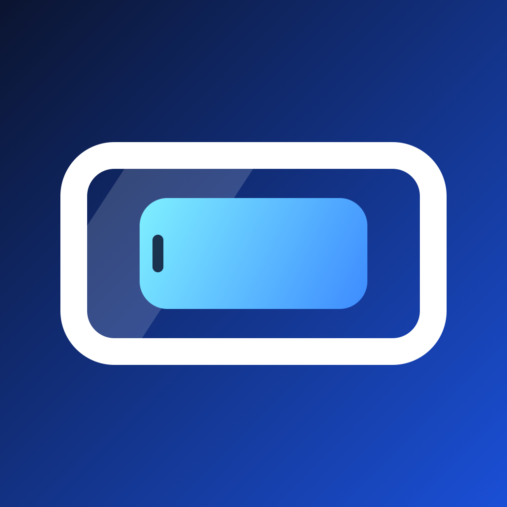

<p align="center">
  
</p>

# DashMirror

Mirror your **whole iPhone screen** – any app, including games played with a Bluetooth controller – into your own
CarPlay window. No jailbreak, no IPA injection, no extra hardware; the mirrored apps stay untouched.
A fail-closed driving lock hides the picture while the car is moving.

> **Use only while parked.** Not affiliated with, endorsed by, or connected to Apple.
> CarPlay is a trademark of Apple Inc. This is a hobby project, not an App Store app – see [Limitations](#limitations).

## Status (November 2026)

| | |
|---|---|
| Works | iPhone 16 Pro, iOS 27.0.1: Apple's CarPlay Simulator and a real BMW over a cable (23 Nov 2026) – mirroring, rotation, picture formats, touches on the car screen. |
| Not tested yet | Wireless CarPlay. Instant replay, blurred background, night mode and heat protection in a real car (simulator only so far). **iOS 27.2 and later** – Apple cracked down on CarPlay video workarounds in 27.2 (App Store removals); whether this approach is affected is unknown. |
| Driving lock | ⚠️ The rule in `DashMirror/Driving/DrivingPolicy.swift` is still a placeholder that **always locks**. Write your rule before use. |
| UI language | English and German. Follows the iPhone language; pick one in the app under *Language* – switches immediately, on the car screen too. |

## How it works

```
iPhone screen (game in front, controller paired to the iPhone)
   │ ReplayKit broadcast: every frame as CMSampleBuffer (always portrait + EXIF orientation)
   ▼
MirrorBroadcast.appex  (separate process, hard 50 MB limit)
   │ scale to the car display's size → H.264 (VideoToolbox, hardware, low-latency rate control)
   │ Unix domain socket in the App Group container
   ▼
DashMirror.app
   │ SPS/PPS + frames → CMSampleBuffer → AVSampleBufferDisplayLayer (hardware decoder)
   │ rotation via layer transform, driving lock hides the picture
   ▼
CarPlay window (UIWindowScene under the role "UIWindowSceneSessionRoleCarPlay")
```

- **Audio** needs no extra path: iOS already plays the game's sound through CarPlay. The app never activates an audio session, so it doesn't interrupt it.
- **Touch on the car screen does not reach the mirrored app** – no public API can inject touches into other apps. Control the game with a controller on the iPhone. A tap on the car screen only cycles the picture format.
- The CarPlay window is a plain `UIWindowScene` under a scene role UIKit exports but doesn't name in Swift – discovered by [rPlayAI/cafari-lite](https://github.com/rPlayAI/cafari-lite). iOS only creates that scene for an app signed with **both** CarPlay entitlements, video and audio.

## Requirements

- A **paid** Apple Developer account and Xcode 26.3 or later; iPhone with iOS 26.2 or later (tested on 27.0.1).
- For the car screen: Apple must grant **both** *CarPlay Video App* and *CarPlay Audio App* to your App ID
  ([developer.apple.com/contact/carplay](https://developer.apple.com/contact/carplay/)). With "video" alone the app
  never appears in the car, without any error. Without the entitlements everything else still works on the phone:
  the full mirroring pipeline, the test pattern and the phone UI.

## Setup

```bash
git clone https://github.com/developer2013/dashmirror.git
cd dashmirror
```

1. `cp Config/Local.xcconfig.example Config/Local.xcconfig` (git-ignored) and set your team ID, bundle ID and App Group.
2. Open `DashMirror.xcodeproj` and run once on your iPhone – automatic signing registers both App IDs
   (`<bundle id>` and `<bundle id>.MirrorBroadcast`) and the App Group.
3. Only if Apple granted both CarPlay entitlements: enable them for your App ID in the developer portal, set
   `DASHMIRROR_ENTITLEMENTS = Config/DashMirror-CarPlay.entitlements` in `Local.xcconfig`, and build once in Xcode so it
   fetches a fresh provisioning profile (an old one gives *"Entitlements … not found and could not be included in profile"*).

## Usage

1. Pair a Bluetooth controller with the iPhone.
2. Connect to CarPlay and open **DashMirror** on the car screen.
3. On the iPhone: **Start mirroring** → *Start Broadcast* (or Control Center → long-press Screen Recording → DashMirror).
4. Switch to your game, put the iPhone down in landscape, play with the controller.
5. Set Auto-Lock to *Never* – locking the iPhone ends the broadcast.

On the car screen: **tap** = control bar (picture format, save clip, stats, reset zoom; hides after 4 s),
**long press** = save a clip of the last 30 s, **pinch** = zoom, **drag** = move the zoomed image. Whether a head unit
delivers multi-touch depends on the car (Apple's CarPlay Simulator doesn't), so the iPhone has the same zoom as a
slider, plus reset.
On the iPhone: frame rate (30/60) and quality (6/12/20 Mbit/s) apply immediately; resolution follows the car display.

Hold the iPhone in landscape: its image is 2.17:1 and fills a wide car display almost completely. Portrait apps stay
a narrow strip; use zoom for those.

Picture formats (the format button in the bar cycles through them; the iPhone shows each one with a short
explanation):

| Format | What it does |
|-|-|
| Automatic (default) | Fills when the shapes differ by less than 15 %, otherwise fits. Never distorts. |
| Fit | Whole picture, black bars. |
| Slight zoom | Zooms in until at most 12 % is cut off. |
| Smart fill | Up to 10 % stretch plus up to 10 % zoom. |
| Slight stretch | Stretches by at most 12 %, the rest stays black bars. |
| Fill (zoom) | Fills completely, edges are cut off. |
| Stretch | Fills completely, distorted. |

In the BMW (2.45:1 display, iPhone landscape 2.17:1) the gap is 13 %, so *Automatic*, *Slight zoom* and *Smart fill*
all come out borderless or nearly so. Which one looks best is still to be tested in the car.

**Black borders are cut off automatically.** Many games leave black bars for the Dynamic Island or render 16:9 on the
19.5:9 screen. The extension detects them and crops before encoding, so the actual content gets bigger. Per axis it
only cuts what is black on *both* sides; when content reaches into a border, the crop shrinks at once, it only grows
after 2 s of stable measurements (dark scenes don't zoom). Toggle: *Cut off black borders*.

**Blurred background instead of black bars.** Where bars remain (portrait apps, *Fit*), the same picture fills the
space behind, enlarged and blurred – like portrait videos on TV. It is a second display layer with its own hardware
decoder, attached only while bars are visible. Toggle: *Blurred background instead of black bars*.

**Instant replay.** The app keeps the last 30 s of the stream it already receives – encoded H.264, in groups starting
at a keyframe (the encoder sets one at least every 2 s), capped at 64 MB. Saving only wraps those frames into an MP4
(`AVAssetWriter` passthrough, no re-encoding; 12 s took 0.04 s in the simulator), rotation goes into the track
transform. Clips go to Photos ("add only" access). iOS can only ask for that access while the DashMirror window is in
front on the iPhone; until then clips wait in the Files app (*On My iPhone › DashMirror › Clips*) and move to Photos
the next time the app is opened. Video only, no sound – the extension sends no audio. A new picture format (car
display change, border crop) or orientation starts the buffer over.

**Night mode.** Dims the car picture with a black layer (15–70 %). *Automatic* follows the car's day/night signal:
CarPlay switches the window's appearance (`userInterfaceStyle`) by headlights or light sensor, as navigation apps use
for their maps. Some cars, or *Always Dark* in the CarPlay settings, report night all the time – the iPhone shows what
the car reports.

**Heat protection.** The app checks the iPhone's thermal state every 0.5 s. At *serious* it lowers resolution to 75 %
and the data rate to 8 Mbit/s, at *critical* to 67 %, 6 Mbit/s and 30 fps – before iOS throttles the game on its own.
The car screen says so briefly. The rule is one small function in `DashMirror/Mirror/ThermalPolicy.swift`: it keeps
60 fps as long as possible, because smoothness usually matters more in games than sharpness on a small car display.

## Driving lock

`DrivingLockMonitor` collects every second: GPS speed, the motion coprocessor's *automotive*/*stationary* state with
confidence, seconds since the last movement, and whether location access is available. `DrivingPolicy.shouldLock`
decides. The monitor starts **locked**; missing data must never look like "parked". When locked, the picture is
removed from the car screen (no frozen frame) and the decoder stops.

Location runs in the background as well (blue status pill) because in the car the game is in front on the iPhone.

In Germany, § 23 (1a) StVO allows a driver to use the screen only when the car is stopped **and the engine is off**
(start-stop does not count) – the app cannot detect the engine. Keep that in mind when writing the rule.

## Testing without a car

```bash
# Build (simulator)
xcodebuild -project DashMirror.xcodeproj -scheme DashMirror \
  -destination "generic/platform=iOS Simulator" -derivedDataPath build build
```

- **Test pattern** (Debug, launch argument `-MirrorTestPattern YES`, also a toggle in the app): runs through the exact
  same chain as the extension (encoder, socket, border crop, decoder, rotation). It is drawn portrait with orientation
  `.right` – like ReplayKit with the iPhone in landscape – and as a 16:9 game with black side bars. If "↑ top" stands
  upright, "top left" is top-left and the bars disappear after ~2 s, rotation and cropping work.
- **CarPlay Simulator** (Additional Tools for Xcode) with the iPhone on a cable.
- **`-MirrorNoDrivingLock YES`** (Debug builds only, this launch only): disables the lock for desk testing; the car
  screen shows a permanent orange "Driving lock OFF – test only" badge. Launched normally, the lock is back.
- More Debug-only launch arguments: `-MirrorCarPreview YES` shows the car screen in the iPhone window (bar, blurred
  background and night mode without a CarPlay display), `-MirrorShowControls YES` keeps the bar visible,
  `-MirrorReplayTest 12` saves a clip after 12 s (file only, no Photos), `-MirrorThermalTest serious` fakes the
  thermal state (the simulator always reports *nominal*).

ReplayKit itself doesn't run in the simulator – real mirroring only on a device.

## Measurements

| Setup | Result |
|---|---|
| Simulator, test pattern | 30 fps, 4–7 ms encoder → app. The simulator has no low-latency encoder (`-12908`) and ignores `MaxFrameDelayCount` (`-12900`); its encoder held frames back and deadlocked a "max 2 in flight" back-pressure rule. Fixed: without low-latency, force output after every frame, plus a 0.5 s escape hatch. |
| iPhone 16 Pro, iOS 27.0.1, test pattern | Hardware low-latency encoder, 30 fps, 9 ms encoder → app. |
| Simulator, 16:9 test pattern with black bars | Bars detected and cut ~2 s after start: 136 px per side (bars are 140 px; the 4 px rest is the safety margin), encoder switches 720×1560 → 720×1288, no frames dropped. |
| Simulator, instant replay | `-MirrorReplayTest 14`: clip of 11.7 s (the buffer restarted when the border crop changed the format), 353 frames, 0.6 MB, written in 0.04 s; plays upright as 1288×720 with the rotation in the track transform. |
| Simulator, heat protection | `-MirrorThermalTest serious`: encoder settings 1920×1080/12 Mbit/s → 1440×810/8 Mbit/s, 60 fps kept. |
| Simulator, blurred background | Second display layer next to the main one, no decoder errors; 0.2 frames/s dropped for a moment while it waited for its first keyframe. |
| iPhone + CarPlay Simulator, real broadcast | Car window 425×255 pt @2x (800×480 native), 49 pt safe-area inset → 752×510 px video area; encoder follows (346×752). Extension: 4 MB at start, 9–10 MB while encoding (limit 50 MB). 23 ms from screen to app incl. ReplayKit. |

**BMW (23 Nov 2026, real car, wired iPhone 16 Pro):** CarPlay window 642×240 pt @3x (1440×540 native), 49 pt sidebar →
1770×723 px video area (2.45:1); 30–57 fps, 12–21 ms screen → app. ReplayKit's orientation `.right` (6) needs a
90° *counter-clockwise* rotation – the opposite of the EXIF reading; the first version showed YouTube upside down.
Netflix stays black (DRM content isn't captured by ReplayKit – by design, not fixable).

ReplayKit only delivers frames when the screen changes – a static screen means few frames, not an error.
**Locking the iPhone ends the broadcast** (measured: iOS finished it 7 s after CarPlay connected, when the phone was
locked); after unlocking it has to be started again. The game is suspended while locked anyway. Set Auto-Lock to
*Never* while playing. Touch on the car screen can't drive other apps, so "phone locked, play by car touch" is
not possible with mirroring.

## Logs

Both processes write to the App Group container (`Logs/app.log`, `Logs/broadcast.log`, viewable and shareable in the
app under *Log*) and a copy into their own container, because `devicectl` may not read App Group containers. The
app's copy is also visible in the Files app (*On My iPhone › DashMirror › Logs*):

```bash
xcrun devicectl device copy from --device <id> --domain-type appDataContainer \
  --domain-identifier <bundle id> --source Documents/Logs/app.log --destination app.log
xcrun devicectl device copy from --device <id> --domain-type appDataContainer \
  --domain-identifier <bundle id>.MirrorBroadcast --source Documents/Logs/broadcast.log --destination broadcast.log
```

## Limitations

- **Not for the App Store.** The window scene role is undocumented, and Apple's CarPlay video category requires apps
  "designed primarily to provide video playback services" with Apple's templates. Apple removed comparable apps in
  October 2026. Build it for yourself.
- **Don't distribute signed builds** to others – CarPlay entitlements are granted to your team under Apple's terms.
- Extra latency from capture, hand-over and the CarPlay video stream (not measured end-to-end yet).
- DRM-protected content (streaming apps) is black in ReplayKit captures.
- Apple can change or remove the window scene role in any iOS release.

## Open tests

- **Pseudo-standby (idea, not tested yet).** iOS ends the broadcast when the iPhone locks, so real standby is out.
  Idea: keep the iPhone unlocked with the game in front, but make its screen practically dark – Accessibility →
  Display & Text Size → *Reduce White Point* 100 % plus minimum brightness, toggled with the Accessibility Shortcut
  (triple-click the side button), Auto-Lock set to *Never*. iOS applies these filters when displaying, and
  screenshots don't contain them, so ReplayKit probably captures the normal, bright image. To verify: does the car
  picture stay bright while the iPhone looks off?
- Wireless CarPlay, longer sessions with a warm iPhone, switching Maps ↔ DashMirror.
- New features in the car: does the blur render on the head unit, does the BMW send a day/night signal (the log says
  `Auto meldet Tag/Nacht`), does heat protection kick in on a warm day, how big is the bar on the 240 pt high screen.
- iOS 27.2 and later.

## Project layout

| Part | Files |
|---|---|
| Wire protocol, socket helpers | `Shared/MirrorProtocol.swift` |
| Encoder (scale + H.264, frame rate, back-pressure, keyframes) | `Shared/MirrorEncoder.swift` |
| Socket client with reconnect; `MirrorStreamer` = encoder + sender | `Shared/MirrorSender.swift` |
| Broadcast extension | `MirrorBroadcast/SampleHandler.swift` |
| Socket server, CMSampleBuffer assembly | `DashMirror/Mirror/MirrorReceiver.swift`, `MirrorPipeline.swift` |
| App state, settings, stats | `DashMirror/Mirror/MirrorHub.swift` |
| Instant replay (ring buffer, MP4 passthrough, Photos) | `DashMirror/Mirror/ReplayBuffer.swift`, `ClipWriter.swift`, `ReplayRecorder.swift` |
| Heat protection rule | `DashMirror/Mirror/ThermalPolicy.swift` |
| Test pattern | `DashMirror/Mirror/TestPattern.swift` |
| Car screen | `DashMirror/CarPlay/*` |
| Driving lock | `DashMirror/Driving/*` |
| Phone UI | `DashMirror/Phone/*` |
| Signing config | `Config/Signing.xcconfig`, `Config/Local.xcconfig.example` |
| App icon | `Design/AppIcon/mobile-casting.svg` (Nucleo, not MIT) → `scripts/make-icon.sh` (needs `brew install librsvg`) |

Code comments are in German.

## Reporting

Every car behaves a little differently (display size, multi-touch, day/night signal). If you try DashMirror, a
[car report](https://github.com/developer2013/dashmirror/issues/new?template=car-report.yml) helps – working or not.
The logs contain speed, but no location.

## Credits

- App icon: *mobile-casting* by [Nucleo](https://nucleoapp.com/).
- [rPlayAI/cafari-lite](https://github.com/rPlayAI/cafari-lite) (MIT) for showing that a plain `UIWindowScene` under
  `UIWindowSceneSessionRoleCarPlay` works with the CarPlay video + audio entitlements. No code was copied.

## Author

Made by Carsten Sachse – [carstensachse.de](https://www.carstensachse.de/).

## License

Code: MIT – see [LICENSE](LICENSE).

The app icon is the *mobile-casting* icon from [Nucleo](https://nucleoapp.com/) and is **not** covered by the MIT
license. It's included under Nucleo's open-source allowance with their copyright notice (see
`Design/AppIcon/mobile-casting.svg`). Redistribution of the icon on its own is prohibited; forks should replace it.
